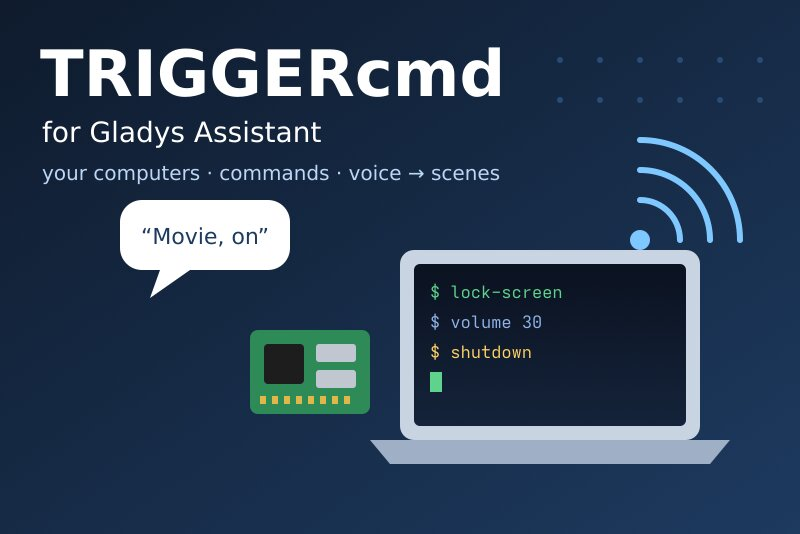
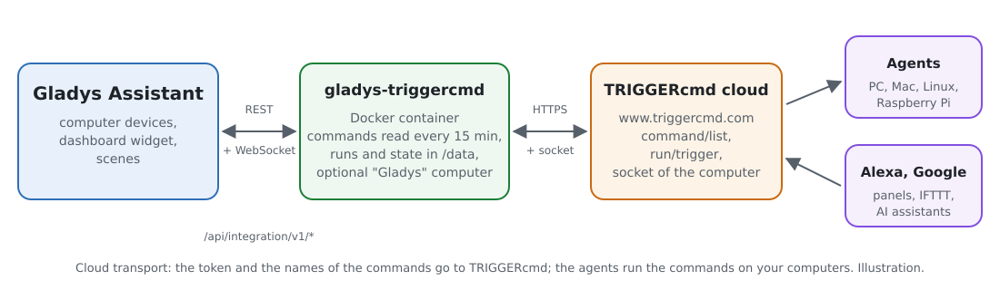
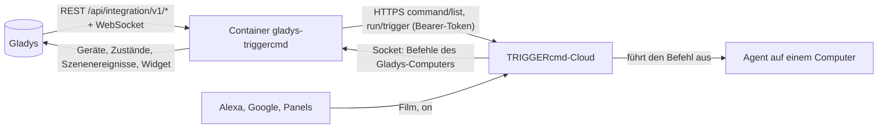
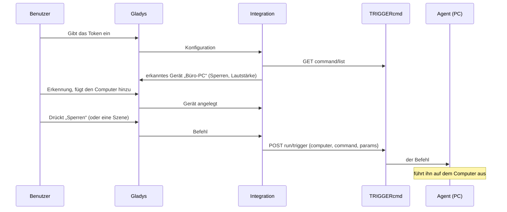
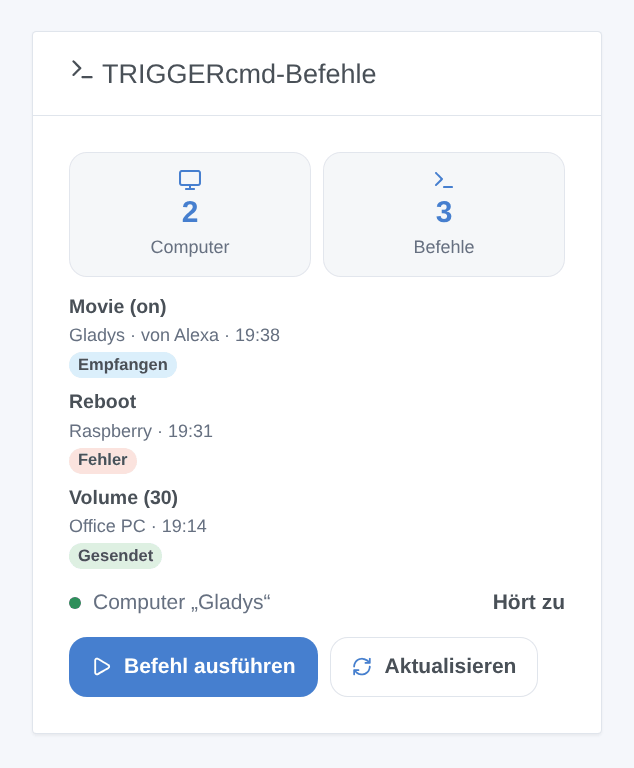

# Gladys TRIGGERcmd

[English](README.md) · [Français](README.fr.md) · **Deutsch** · [Español](README.es.md)

[](LICENSE)
[](https://github.com/William-De71/gladys-triggercmd/releases)
[](https://github.com/William-De71/gladys-triggercmd/actions/workflows/release.yml)
[](https://gladysassistant.com)



Externe Integration von [Gladys Assistant](https://gladysassistant.com) für [TRIGGERcmd](https://www.triggercmd.com), über seine API und das Token deines Kontos. Sie führt die Befehle deiner Computer (Windows, Mac, Linux, Raspberry Pi mit dem TRIGGERcmd-Agenten) aus Gladys-Geräten, Szenen und einem Dashboard-Widget aus und startet mit dem optionalen Computer „Gladys“ Gladys-Szenen über Alexa, Google Assistant oder ein TRIGGERcmd-Panel.

Benutzerdokumentation: [English](docs/en.md) · [Français](docs/fr.md) · [Deutsch](docs/de.md) · [Español](docs/es.md).

Nicht mit TRIGGERcmd verbunden. **Noch nicht mit einem echten TRIGGERcmd-Konto getestet**: Die Anfragen folgen der Dokumentation von TRIGGERcmd und dem Code seines offiziellen Agenten und seiner Clients; die Antworten auf ein falsches Token wurden live geprüft, über HTTP wie über den Socket.

## Funktionen

- Alle **Computer** des Kontos mit ihren **Befehlen**, selbst gefunden, alle 15 Minuten und auf Anfrage neu gelesen.
- **Ein Gerät pro Computer**: eine **Taste** pro Befehl, oder ein **Ein/Aus-Schalter** für einen Befehl, der Parameter annimmt (Ein sendet `on`, Aus sendet `off`, das „Off Command“ des Agenten).
- **Szenenaktion** „Befehl ausführen“ nach den Namen des Computers und des Befehls, mit Parametern (Szenenvariablen möglich), und „Befehle neu lesen“.
- **3 Szenenauslöser**: Ein Befehl des Gladys-Computers wurde ausgeführt (Alexa, Google…), TRIGGERcmd hat einen von Gladys gesendeten Befehl abgelehnt, das Token wird abgelehnt.
- **Ein Dashboard-Widget**: die letzten Ausführungen (gesendet, abgelehnt, empfangen mit Absender) und ein Formular **Befehl ausführen**, das die Befehle mit ihren Parametern auflistet.
- **Der Gladys-Computer** (optional): Gladys erscheint in TRIGGERcmd als weiterer Computer; seine Befehle starten Gladys-Szenen in Echtzeit.
- Vier Sprachen überall: Englisch, Französisch, Deutsch, Spanisch.

## Funktionsweise





Vom Befehl zur Ausführung:



### Transport

`transports: ["cloud"]`: Alles läuft über die TRIGGERcmd-Cloud (`www.triggercmd.com`), die die Befehle an die Agenten deiner Computer weiterleitet. **Das Token, die Namen deiner Computer und Befehle und die Parameter verlassen dein Netzwerk** (nur zu TRIGGERcmd). Der Gladys-Computer hört auf den Socket von TRIGGERcmd (ein von der Integration geöffneter WebSocket, kein Port in deinem Netzwerk geöffnet). `/data` speichert einen Fingerabdruck des Kontos, die Computer und ihre Befehle, die ID des Gladys-Computers und die letzten Ausführungen — nie das Token.

## Geräte und Funktionen

| Gerät             | Funktionen (Kategorie / Typ)                                                                                                          |
| ----------------- | ------------------------------------------------------------------------------------------------------------------------------------- |
| Eins pro Computer | Eine pro Befehl: `button` / `push` (ein Druck führt den Befehl aus), oder `switch` / `binary` für einen Befehl, der Parameter annimmt |

- TRIGGERcmd sagt nie, ob ein Befehl „an“ ist: Ein Schalter zeigt, was Gladys zuletzt gesendet hat (wie Home Assistant).
- Externe IDs beruhen auf der ID des Computers in TRIGGERcmd (`ext:triggercmd:computer:<id>`) und einem Hash des Befehlsnamens: Der Agent legt einen Befehl neu an, wenn er bearbeitet wird, und führt ihn über seinen Namen aus.
- Ein Computer ohne Befehl wird nicht angeboten; der Gladys-Computer auch nicht (seine Befehle starten Szenen).
- Höchstens 100 Befehle pro Computer.

## Szenenauslöser, Aktionen und Widget



**Widget** „TRIGGERcmd-Befehle“ (ein Computer oder alle): wie viele Computer und Befehle, der Zustand des Gladys-Computers, die letzten Ausführungen mit einem Abzeichen (gesendet, Fehler, empfangen von Alexa…), eine Schaltfläche **Befehl ausführen**, deren Formular die Befehle auflistet (höchstens 40) mit einem Parameterfeld, und eine Schaltfläche **Aktualisieren**.

**Auslöser**:

- **Befehl empfangen**: Ein Befehl des Gladys-Computers wurde in TRIGGERcmd ausgeführt (Filter: der Befehl, ein oder aus); Variablen: der Befehl, seine Parameter, `on` / `off`, der Absender (Alexa, Google Assistant, ein Panel…);
- **Befehl abgelehnt**: TRIGGERcmd hat einen Befehl von einem Gerät oder dem Widget abgelehnt (Filter: der Grund — unbekannter Befehl, zu viele Befehle, Token, Abo, nicht erreichbar); nie durch die Aktion `run_command` ausgelöst, die stattdessen fehlschlägt;
- **Token abgelehnt**: einmal pro Ablehnung.

**Aktionen**:

- **Befehl ausführen**: Computer und Befehl nach ihren Namen (Groß- und Kleinschreibung egal), optionale Parameter; gibt die gefundenen Namen und die Antwort von TRIGGERcmd zurück. Ein der Integration unbekannter Befehl lässt sie die Liste einmal neu lesen.
- **Befehle neu lesen**: die Anzahl der Computer und Befehle; neue Befehle erscheinen in der Erkennung.

Beispiele:

- „Alexa, schalte Film ein“ → **TRIGGERcmd: Befehl empfangen** (Film, on) → Rollläden schließen, Licht dimmen.
- Jeden Abend um 23:00 → **TRIGGERcmd: Befehl ausführen** (Büro-PC, Bildschirm sperren).
- Wenn **TRIGGERcmd: Befehl abgelehnt** → „{{triggerEvent.data.command}} auf {{triggerEvent.data.computer}}: {{triggerEvent.data.message}}“ senden.

### Der Gladys-Computer

In der Konfiguration eingeschaltet, legt die Integration einen Computer (standardmäßig „Gladys“) in deinem TRIGGERcmd-Konto an, hält seine Befehle mit der Liste der Konfiguration abgeglichen (Parameter erlaubt) und hört auf ihn. Alexa (Skill TRIGGERcmd Smart Home), Google Assistant, ein TRIGGERcmd-Panel, IFTTT, Zapier oder ein KI-Assistent (MCP) führen diese Befehle wie alle anderen aus: Gladys empfängt sie in Echtzeit, löst **Befehl empfangen** aus und meldet „Command ran“ an die Ausführungsliste von triggercmd.com. Ein von Gladys selbst gesendeter Befehl löst nie eine Szene aus, und Gladys weigert sich, den Gladys-Computer aus einer Szene zu steuern: keine Schleife.

## Voraussetzungen

- Gladys Assistant **5.3.0** oder neuer (Widgets und Szenen der Integrationen, Katalog-Schlüsselwörter von Gladys 5.3): Ältere Instanzen können die Integration nicht installieren.
- Ein TRIGGERcmd-Konto und sein Agent auf jedem zu steuernden Computer, mit Befehlen.
- Internet: Die Integration spricht nur mit `www.triggercmd.com`.

### Tarife und Takt

Der kostenlose Tarif von TRIGGERcmd erlaubt **einen Computer** und führt **einen Befehl pro Minute** aus (ein zweiter in derselben Minute wird von TRIGGERcmd verworfen); das Abonnement hat keine Grenze. Der Gladys-Computer zählt als Computer: Ist in einem kostenlosen Konto schon einer, braucht es das Abonnement (Gladys sagt es klar und behält den Rest). Das Lesen der Befehle ist nicht begrenzt; die Integration liest sie alle 15 Minuten, eine Anfrage nach der anderen, und pausiert nach einem 429 alles für die Dauer seines Retry-After.

## Installation

- **Aus dem Store**: Integrationen → TRIGGERcmd → Installieren.
- **Über die URL des Repositorys**: Integrationen → externe Integration → `https://github.com/William-De71/gladys-triggercmd`.
- **Entwicklermodus**: `npm start` mit den von Gladys bereitgestellten Variablen starten (siehe Entwicklung).

## Konfiguration

| Feld oder Schaltfläche       | Standard | Bedeutung                                                                                         |
| ---------------------------- | -------- | ------------------------------------------------------------------------------------------------- |
| Token                        | —        | Pflicht, geheim: das Token der Seite „Instructions“ auf triggercmd.com, nie protokolliert         |
| Gladys-Computer anlegen      | aus      | Fügt den Gladys-Computer dem Konto hinzu und hört auf ihn                                         |
| Name des Computers           | Gladys   | Sein Name in TRIGGERcmd; eine Änderung legt einen weiteren Computer an                            |
| Befehle                      | —        | Die Namen seiner Befehle, durch Kommas getrennt (die Namen, die Alexa und Google kennen), max. 50 |
| Verbindung testen / Diagnose | —        | Die Computer und Befehle, der Gladys-Computer; der Zustand in den Logs, ohne Token                |

## Verwendung

1. Öffne auf triggercmd.com die Seite **Instructions** und kopiere das Token; installiere den Agenten auf deinen Computern und füge Befehle hinzu.
2. In Gladys (Integrationen → TRIGGERcmd → Konfiguration): Token einfügen, **Verbindung testen** drücken.
3. **Erkennung**, dann deine Computer als Geräte hinzufügen; das Widget zu einem Dashboard hinzufügen.
4. Optional: den Gladys-Computer einschalten, seine Befehle auflisten, dann den Skill TRIGGERcmd Smart Home in der Alexa-App (oder die Aktion in Google Home) verknüpfen und Szenen auf **Befehl empfangen** bauen.

## Entwicklung

```bash
npm install
npm test                       # node --test, ein falsches TRIGGERcmd (fetch im Speicher, falscher Socket), nie das Netzwerk
npm run lint                   # ESLint
npm run format:check           # Prettier
npx github:GladysAssistant/integration-store . --skip-image-check
scripts/build-cover.sh         # cover.jpg aus docs/assets/cover.svg
docs/illustrations/render.sh   # docs/assets/widgets.<lang>.png
```

Lokal liest das SDK `GLADYS_HOST_API_URL`, `GLADYS_INTEGRATION_TOKEN` und `GLADYS_INTEGRATION_SELECTOR` (von Gladys im Entwicklermodus bereitgestellt), und die Integration liest `TZ`. `DEBUG=gladys-integration-sdk` zeigt die Logs des SDK.

Die einzige Laufzeitabhängigkeit ist das SDK: Der Socket des Gladys-Computers ist ein kleiner socket.io-2-Client über dem WebSocket von Node.js (socket.io-client 2 hat eine ungelöste Sicherheitswarnung). Die Tests decken den HTTP-Client (Bodies, Formulare, 401 / 403 / 404 / 429 / 5xx), das Lesen der Antworten, das Socket-Protokoll (Öffnen, Abonnement, Ereignisse, Wiederverbindung, Ablehnung), die Geräte, das Widget (`validateWidgetContent`), das Manifest, die vier Sprachen, das Release-Skript und die ganze Integration gegen das falsche Gladys des SDK und ein falsches TRIGGERcmd ab. `test/structure.test.js` friert alle Schlüssel ein, die Benutzer speichern.

## Release-Prozess


Jeder Merge auf `main` startet die CI und berechnet dann die Version aus den [Conventional Commits](https://www.conventionalcommits.org/) seit dem letzten Tag: `feat` → Minor, `fix` / `perf` → Patch, `!` oder `BREAKING CHANGE` → Major (Minor vor 1.0.0); `docs`, `chore`, `ci`, `test`, `style`, `refactor`, `build` allein veröffentlichen nichts. Der Changelog-Abschnitt wird erzeugt, der Tag gepusht, das Multi-Architektur-Image gebaut, dann erhält `main` den Release-Commit, das GitHub-Release wird angelegt und ein letzter Job prüft das öffentliche Image, den Store-Validator und das Topic.

- Der Titel des Pull Requests wird zum Squash-Commit und dann zur Changelog-Zeile: auf Englisch, für den Benutzer schreiben (`pr-title.yml` prüft ihn). `CHANGELOG.md` nie von Hand bearbeiten.
- 1.0.0 ist eine Entscheidung: Actions → Release → Run workflow mit `release-as: 1.0.0`. `dry-run` zeigt Version und Notizen, ohne zu veröffentlichen.
- **Geschützter Branch**: Das Release pusht seinen Commit mit `GITHUB_TOKEN` auf `main`. Das Ruleset `protect-main` (kein Löschen, kein Force-Push) lässt ihn durch; eine strengere Regel (Pull Request Pflicht, Status-Checks) bräuchte GitHub Actions in ihrer Bypass-Liste oder eine GitHub App.
- Nach dem ersten Release das Paket `ghcr.io` öffentlich machen (Package settings → Change visibility), sonst kann Gladys es nicht laden.

## Fehlerbehebung

Siehe [docs/de.md](docs/de.md#fehlerbehebung). Melde Probleme mit den Versionen von Gladys und der Integration, deinem TRIGGERcmd-Tarif, der Meldung von **Verbindung testen** und dem Ergebnis von **Diagnose** (in den Logs der Integration). Füge nie dein Token ein.

## Mitwirken

Issues und Pull Requests sind willkommen. Führe `npm run format:check && npm run lint && npm test` aus, bevor du einen Pull Request öffnest, und ändere keine externe ID und keinen gespeicherten Schlüssel (siehe [CLAUDE.md](CLAUDE.md)).

## Sicherheit

Siehe [SECURITY.md](SECURITY.md): Sicherheitslücken bitte privat melden. Das Token ist ein `secret`-Feld: nie protokolliert, nie in `/data` geschrieben, nur an `www.triggercmd.com` gesendet. Wer das Token hat, kann die Befehle deiner Computer ausführen: Bewahre es wie ein Passwort auf und erneuere es auf triggercmd.com, falls es nach außen gelangt.

## Kommende Screenshots

Die Bilder oben sind Illustrationen, keine Screenshots. Echte Screenshots kommen nach `docs/assets/screenshots/` (PNG, 1280 × 800): `configuration.png`, `discovery.png` (die angebotenen Computer), `device.png` (ein Computer mit seinen Tasten und Schaltern), `scene-alexa.png` (eine Szene auf „Befehl empfangen“), `dashboard.png` (das Widget mit echten Ausführungen).

## Lizenz

[Apache-Lizenz 2.0](LICENSE) — siehe auch [NOTICE](NOTICE). TRIGGERcmd ist eine Marke ihres Inhabers. Dank an die Dokumentation und das SDK von Gladys, an TRIGGERcmd für seine Dokumentation und seinen quelloffenen Agenten und seine Clients sowie an die Autoren der Home-Assistant-Integration „TRIGGERcmd“.
