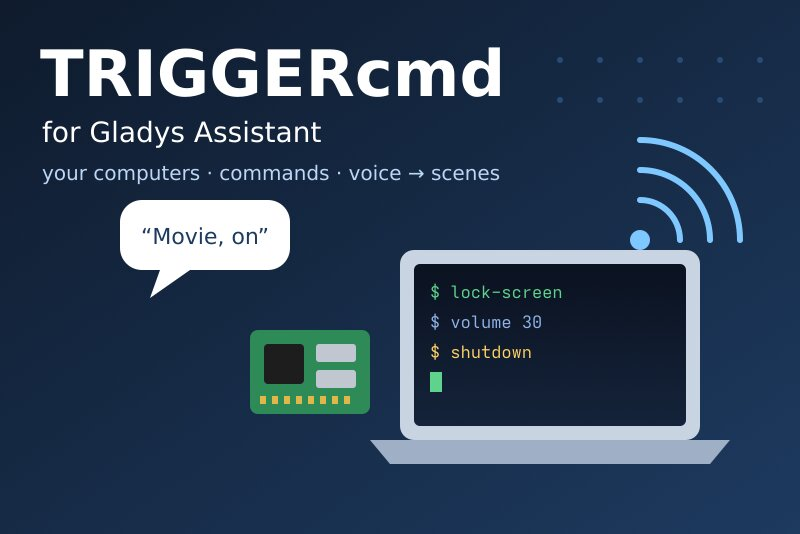
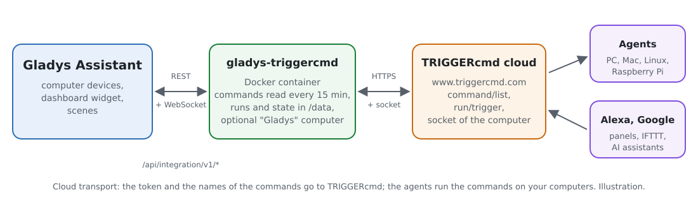
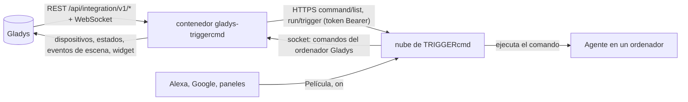
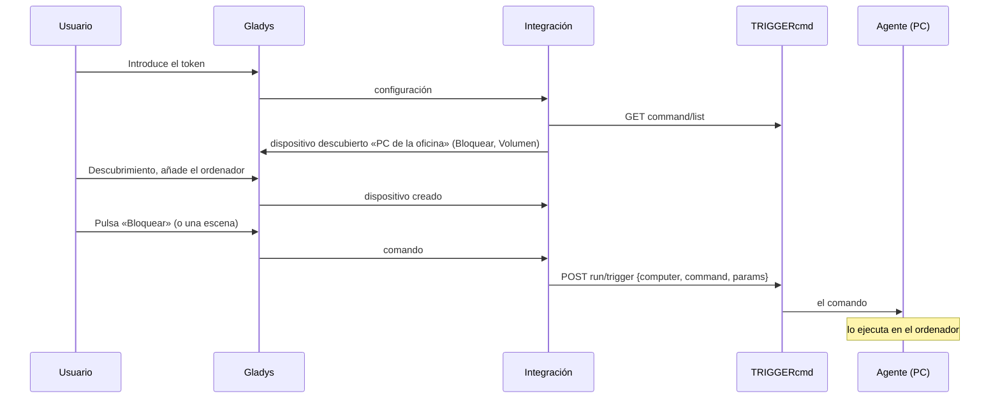
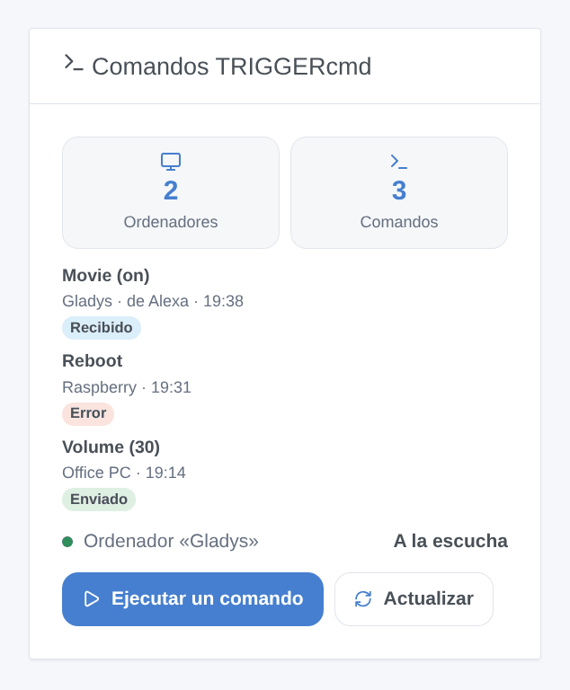

# Gladys TRIGGERcmd

[English](README.md) · [Français](README.fr.md) · [Deutsch](README.de.md) · **Español**

[](LICENSE)
[](https://github.com/William-De71/gladys-triggercmd/releases)
[](https://github.com/William-De71/gladys-triggercmd/actions/workflows/release.yml)
[](https://gladysassistant.com)



Integración externa de [Gladys Assistant](https://gladysassistant.com) para [TRIGGERcmd](https://www.triggercmd.com), mediante su API y el token de su cuenta. Ejecuta los comandos de sus ordenadores (Windows, Mac, Linux, Raspberry Pi con el agente de TRIGGERcmd) desde dispositivos, escenas y un widget de Gladys y, con el ordenador «Gladys» opcional, lanza escenas de Gladys desde Alexa, Google Assistant o un panel de TRIGGERcmd.

Documentación de usuario: [English](docs/en.md) · [Français](docs/fr.md) · [Deutsch](docs/de.md) · [Español](docs/es.md).

No afiliada a TRIGGERcmd. **Aún no probada con una cuenta real de TRIGGERcmd**: las peticiones siguen la documentación de TRIGGERcmd y el código de su agente y sus clientes oficiales; las respuestas a un token incorrecto se comprobaron en real, por HTTP y por el socket.

## Funciones

- Todos los **ordenadores** de la cuenta con sus **comandos**, encontrados solos, releídos cada 15 minutos y bajo demanda.
- **Un dispositivo por ordenador**: un **pulsador** por comando, o un **interruptor encendido/apagado** para un comando que acepta parámetros (encendido envía `on`, apagado envía `off`, el «Off Command» del agente).
- **Acción de escena** «ejecutar un comando» por los nombres del ordenador y del comando, con parámetros (se admiten variables de escena), y «releer los comandos».
- **3 disparadores de escena**: se ejecutó un comando del ordenador Gladys (Alexa, Google…), TRIGGERcmd rechazó un comando enviado por Gladys, el token es rechazado.
- **Un widget**: las últimas ejecuciones (enviadas, rechazadas, recibidas con su remitente) y un formulario **Ejecutar un comando** que lista los comandos, con sus parámetros.
- **El ordenador Gladys** (opcional): Gladys aparece en TRIGGERcmd como un ordenador más; sus comandos lanzan escenas de Gladys en tiempo real.
- Cuatro idiomas en todas partes: inglés, francés, alemán, español.

## Funcionamiento





De un comando a su ejecución:



### Transporte

`transports: ["cloud"]`: todo pasa por la nube de TRIGGERcmd (`www.triggercmd.com`), que transmite los comandos a los agentes de sus ordenadores. **El token, los nombres de sus ordenadores y comandos y los parámetros salen de su red** (solo hacia TRIGGERcmd). El ordenador Gladys escucha el socket de TRIGGERcmd (un WebSocket abierto por la integración, ningún puerto abierto en su red). `/data` guarda una huella de la cuenta, los ordenadores y sus comandos, el identificador del ordenador Gladys y las últimas ejecuciones — nunca el token.

## Dispositivos y funciones

| Dispositivo       | Funciones (categoría / tipo)                                                                                                  |
| ----------------- | ----------------------------------------------------------------------------------------------------------------------------- |
| Uno por ordenador | Una por comando: `button` / `push` (pulsarlo ejecuta el comando), o `switch` / `binary` para un comando que acepta parámetros |

- TRIGGERcmd nunca dice si un comando está «encendido»: un interruptor muestra lo último que Gladys envió (como Home Assistant).
- Los identificadores externos se basan en el identificador del ordenador en TRIGGERcmd (`ext:triggercmd:computer:<id>`) y en una huella del nombre del comando: el agente vuelve a crear un comando cuando se edita, y lo ejecuta por su nombre.
- Un ordenador sin comandos no se ofrece; el ordenador Gladys tampoco (sus comandos lanzan escenas).
- 100 comandos por ordenador como máximo.

## Disparadores, acciones de escena y widget



**Widget** «Comandos TRIGGERcmd» (un ordenador, o todos): cuántos ordenadores y comandos, el estado del ordenador Gladys, las últimas ejecuciones con una insignia (enviado, error, recibido de Alexa…), un botón **Ejecutar un comando** cuyo formulario lista los comandos (40 como máximo) con un campo de parámetros, y un botón **Actualizar**.

**Disparadores**:

- **comando recibido**: se ejecutó un comando del ordenador Gladys en TRIGGERcmd (filtros: el comando, encender o apagar); variables: el comando, sus parámetros, `on` / `off`, el remitente (Alexa, Google Assistant, un panel…);
- **comando rechazado**: TRIGGERcmd rechazó un comando enviado desde un dispositivo o el widget (filtro: el motivo — comando desconocido, demasiados comandos, token, suscripción, inaccesible); nunca lo dispara la acción `run_command`, que falla en su lugar;
- **token rechazado**: una vez por rechazo.

**Acciones**:

- **ejecutar un comando**: el ordenador y el comando por sus nombres (mayúsculas indiferentes), parámetros opcionales; devuelve los nombres encontrados y la respuesta de TRIGGERcmd. Un comando desconocido para la integración le hace releer la lista una vez.
- **releer los comandos**: el número de ordenadores y comandos; los nuevos comandos aparecen en el descubrimiento.

Ejemplos:

- «Alexa, enciende Película» → **TRIGGERcmd: comando recibido** (Película, on) → cerrar las persianas, atenuar las luces.
- Cada noche a las 23:00 → **TRIGGERcmd: ejecutar un comando** (PC de la oficina, Bloquear pantalla).
- Cuando **TRIGGERcmd: comando rechazado** → enviar «{{triggerEvent.data.command}} en {{triggerEvent.data.computer}}: {{triggerEvent.data.message}}».

### El ordenador Gladys

Activado en la configuración, la integración crea un ordenador (llamado «Gladys» por defecto) en su cuenta de TRIGGERcmd, alinea sus comandos con la lista de la configuración (parámetros permitidos) y lo escucha. Alexa (skill TRIGGERcmd Smart Home), Google Assistant, un panel de TRIGGERcmd, IFTTT, Zapier o un asistente de IA (MCP) ejecutan estos comandos como cualquier otro: Gladys los recibe en tiempo real, dispara **comando recibido** y comunica «Command ran» a la lista de ejecuciones de triggercmd.com. Un comando enviado por la propia Gladys nunca dispara una escena, y Gladys se niega a controlar el ordenador Gladys desde una escena: sin bucle.

## Requisitos

- Gladys Assistant **5.3.0** o posterior (widgets y escenas de las integraciones, palabras clave del catálogo de Gladys 5.3): las instancias anteriores no pueden instalar la integración.
- Una cuenta de TRIGGERcmd, y su agente instalado en cada ordenador que se quiera controlar, con comandos.
- Internet: la integración solo habla con `www.triggercmd.com`.

### Planes y ritmo

El plan gratuito de TRIGGERcmd admite **un ordenador** y ejecuta **un comando por minuto** (TRIGGERcmd descarta un segundo comando en el mismo minuto); la suscripción no tiene límite. El ordenador Gladys cuenta como un ordenador: si ya hay uno en una cuenta gratuita, se necesita la suscripción (Gladys lo dice claramente y mantiene el resto). La lectura de los comandos no está limitada; la integración los lee cada 15 minutos, una petición a la vez, y tras un 429 lo pausa todo durante su Retry-After.

## Instalación

- **Desde la tienda**: Integraciones → TRIGGERcmd → Instalar.
- **Desde la URL del repositorio**: Integraciones → integración externa → `https://github.com/William-De71/gladys-triggercmd`.
- **Modo desarrollador**: ejecute `npm start` con las variables que da Gladys (ver Desarrollo).

## Configuración

| Campo o botón                    | Por defecto | Función                                                                                                   |
| -------------------------------- | ----------- | --------------------------------------------------------------------------------------------------------- |
| Token                            | —           | Obligatorio, secreto: el token de la página «Instructions» de triggercmd.com, nunca registrado            |
| Crear el ordenador Gladys        | desactivado | Añade el ordenador Gladys a la cuenta y lo escucha                                                        |
| Nombre del ordenador             | Gladys      | Su nombre en TRIGGERcmd; cambiarlo crea otro ordenador                                                    |
| Comandos                         | —           | Los nombres de sus comandos, separados por comas (los nombres que conocen Alexa y Google), 50 como máximo |
| Probar la conexión / Diagnóstico | —           | Los ordenadores y comandos, el ordenador Gladys; el estado en los registros, sin el token                 |

## Uso

1. En triggercmd.com, abra la página **Instructions** y copie el token; instale el agente en sus ordenadores y añádales comandos.
2. En Gladys (Integraciones → TRIGGERcmd → Configuración): pegue el token y pulse **Probar la conexión**.
3. **Descubrimiento**, luego añada sus ordenadores como dispositivos; añada el widget a un panel.
4. Opcional: active el ordenador Gladys, liste sus comandos, vincule la skill TRIGGERcmd Smart Home en la aplicación Alexa (o la acción en Google Home) y cree escenas sobre **comando recibido**.

## Desarrollo

```bash
npm install
npm test                       # node --test, un TRIGGERcmd falso (fetch en memoria, socket falso), nunca la red
npm run lint                   # ESLint
npm run format:check           # Prettier
npx github:GladysAssistant/integration-store . --skip-image-check
scripts/build-cover.sh         # cover.jpg desde docs/assets/cover.svg
docs/illustrations/render.sh   # docs/assets/widgets.<lang>.png
```

En local, el SDK lee `GLADYS_HOST_API_URL`, `GLADYS_INTEGRATION_TOKEN` y `GLADYS_INTEGRATION_SELECTOR` (dados por Gladys en modo desarrollador), y la integración lee `TZ`. `DEBUG=gladys-integration-sdk` muestra los registros del SDK.

La única dependencia de ejecución es el SDK: el socket del ordenador Gladys es un pequeño cliente socket.io 2 escrito sobre el WebSocket de Node.js (socket.io-client 2 tiene un aviso de seguridad sin corregir). Las pruebas cubren el cliente HTTP (cuerpos, formularios, 401 / 403 / 404 / 429 / 5xx), la lectura de las respuestas, el protocolo del socket (apertura, suscripción, eventos, reconexión, rechazo), los dispositivos, el widget (`validateWidgetContent`), el manifiesto, los cuatro idiomas, el script de release y toda la integración frente al Gladys falso del SDK y un TRIGGERcmd falso. `test/structure.test.js` congela todas las claves que guardan los usuarios.

## Proceso de release


Cada fusión en `main` lanza la CI y luego calcula la versión a partir de los [Conventional Commits](https://www.conventionalcommits.org/) desde la última etiqueta: `feat` → menor, `fix` / `perf` → parche, `!` o `BREAKING CHANGE` → mayor (menor antes de 1.0.0); `docs`, `chore`, `ci`, `test`, `style`, `refactor`, `build` solos no publican nada. Se genera la sección del changelog, se sube la etiqueta, se construye la imagen multiarquitectura, luego `main` recibe el commit de release, se crea la GitHub Release y un último job comprueba la imagen pública, el validador de la tienda y el topic.

- El título de la pull request se convierte en el commit squash y luego en la línea del changelog: escríbalo en inglés, para el usuario (`pr-title.yml` lo comprueba). Nunca edite `CHANGELOG.md` a mano.
- 1.0.0 es una decisión: Actions → Release → Run workflow con `release-as: 1.0.0`. `dry-run` muestra la versión y las notas sin publicar.
- **Rama protegida**: la release sube su commit a `main` con `GITHUB_TOKEN`. El ruleset `protect-main` (sin borrado ni force-push) lo deja pasar; una regla más estricta (pull request obligatoria, status checks) necesitaría GitHub Actions en su lista de excepciones, o una GitHub App.
- Tras la primera release, haga público el paquete `ghcr.io` (Package settings → Change visibility), o Gladys no podrá descargarlo.

## Solución de problemas

Vea [docs/es.md](docs/es.md#solución-de-problemas). Informe de los problemas con las versiones de Gladys y de la integración, su plan de TRIGGERcmd, el mensaje de **Probar la conexión** y el resultado de **Diagnóstico** (en los registros de la integración). Nunca pegue su token.

## Contribuir

Las issues y pull requests son bienvenidas. Ejecute `npm run format:check && npm run lint && npm test` antes de abrir una pull request, y no cambie ningún identificador externo ni ninguna clave guardada (vea [CLAUDE.md](CLAUDE.md)).

## Seguridad

Vea [SECURITY.md](SECURITY.md): informe de las vulnerabilidades en privado. El token es un campo `secret`: nunca registrado, nunca escrito en `/data`, enviado solo a `www.triggercmd.com`. Quien tenga el token puede ejecutar los comandos de sus ordenadores: guárdelo como una contraseña y regenérelo en triggercmd.com si se filtra.

## Capturas por venir

Las imágenes de arriba son ilustraciones, no capturas de pantalla. Las capturas reales irán en `docs/assets/screenshots/` (PNG, 1280 × 800): `configuration.png`, `discovery.png` (los ordenadores ofrecidos), `device.png` (un ordenador con sus pulsadores e interruptores), `scene-alexa.png` (una escena sobre «comando recibido»), `dashboard.png` (el widget con ejecuciones reales).

## Licencia

[Licencia Apache 2.0](LICENSE) — vea también [NOTICE](NOTICE). TRIGGERcmd es una marca de su propietario. Gracias a la documentación y al SDK de Gladys, a TRIGGERcmd por su documentación y su agente y clientes de código abierto, y a los autores de la integración «TRIGGERcmd» de Home Assistant.
