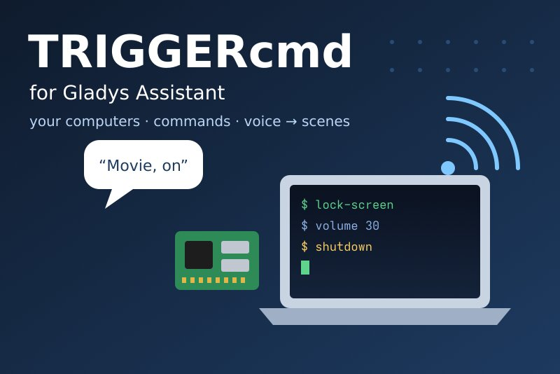
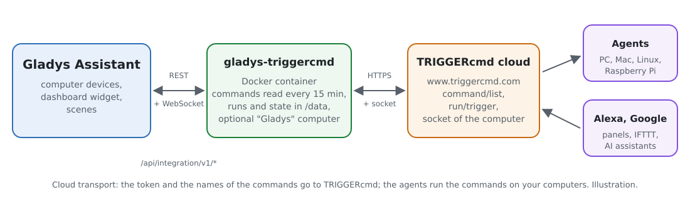
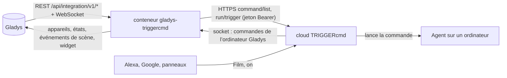
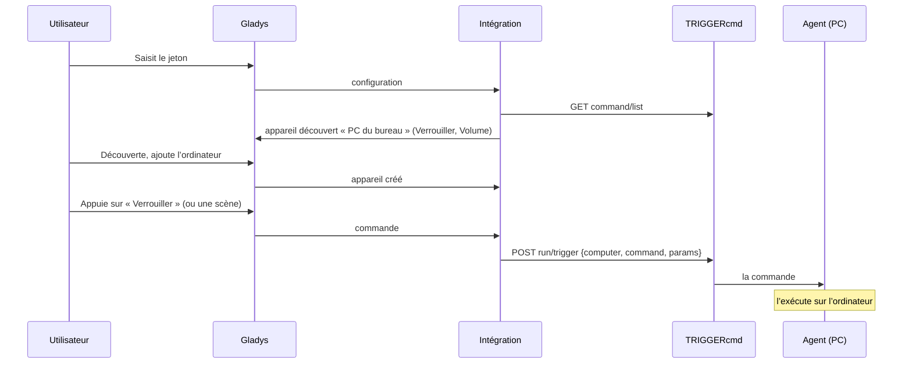
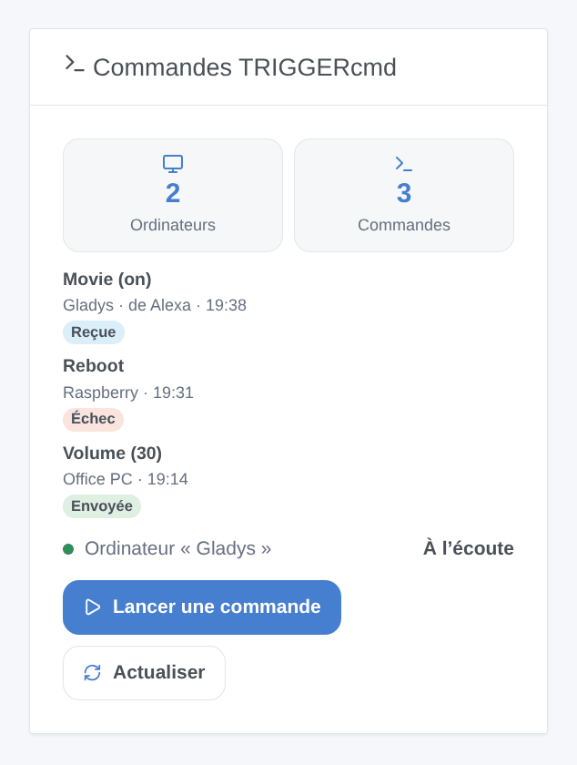

# Gladys TRIGGERcmd

[English](README.md) · **Français** · [Deutsch](README.de.md) · [Español](README.es.md)

[](LICENSE)
[](https://github.com/William-De71/gladys-triggercmd/releases)
[](https://github.com/William-De71/gladys-triggercmd/actions/workflows/release.yml)
[](https://gladysassistant.com)



Intégration externe de [Gladys Assistant](https://gladysassistant.com) pour [TRIGGERcmd](https://www.triggercmd.com), par son API et le jeton de votre compte. Elle lance les commandes de vos ordinateurs (Windows, Mac, Linux, Raspberry Pi avec l’agent TRIGGERcmd) depuis des appareils, des scènes et un widget Gladys, et, avec l’ordinateur « Gladys » facultatif, déclenche des scènes Gladys depuis Alexa, Google Assistant ou un panneau TRIGGERcmd.

Documentation utilisateur : [English](docs/en.md) · [Français](docs/fr.md) · [Deutsch](docs/de.md) · [Español](docs/es.md).

Non affiliée à TRIGGERcmd. **Pas encore testée avec un vrai compte TRIGGERcmd** : les requêtes suivent la documentation de TRIGGERcmd et le code de son agent et de ses clients officiels ; les réponses à un mauvais jeton ont été vérifiées en réel, en HTTP comme sur le socket.

## Fonctionnalités

- Tous les **ordinateurs** du compte avec leurs **commandes**, trouvés seuls, relus toutes les 15 minutes et à la demande.
- **Un appareil par ordinateur** : un **bouton poussoir** par commande, ou un **interrupteur marche/arrêt** pour une commande qui accepte des paramètres (marche envoie `on`, arrêt envoie `off`, la « Off Command » de l’agent).
- **Action de scène** « lancer une commande » par les noms de l’ordinateur et de la commande, avec des paramètres (variables de scène acceptées), et « relire les commandes ».
- **3 déclencheurs de scène** : une commande de l’ordinateur Gladys a été lancée (Alexa, Google…), TRIGGERcmd a refusé une commande envoyée par Gladys, le jeton est refusé.
- **Un widget** : les dernières commandes (envoyées, refusées, reçues avec leur expéditeur) et un formulaire **Lancer une commande** qui liste les commandes, avec leurs paramètres.
- **L’ordinateur Gladys** (facultatif) : Gladys apparaît dans TRIGGERcmd comme un ordinateur de plus ; ses commandes lancent des scènes Gladys en temps réel.
- Quatre langues partout : anglais, français, allemand, espagnol.

## Fonctionnement





D’une commande à son exécution :



### Transport

`transports: ["cloud"]` : tout passe par le cloud de TRIGGERcmd (`www.triggercmd.com`), qui relaie les commandes aux agents de vos ordinateurs. **Le jeton, les noms de vos ordinateurs et commandes et les paramètres quittent votre réseau** (vers TRIGGERcmd uniquement). L’ordinateur Gladys écoute le socket de TRIGGERcmd (un WebSocket ouvert par l’intégration, aucun port ouvert sur votre réseau). `/data` garde une empreinte du compte, les ordinateurs et leurs commandes, l’identifiant de l’ordinateur Gladys et les dernières commandes — jamais le jeton.

## Appareils et fonctionnalités

| Appareil          | Fonctionnalités (catégorie / type)                                                                                                    |
| ----------------- | ------------------------------------------------------------------------------------------------------------------------------------- |
| Un par ordinateur | Une par commande : `button` / `push` (l’appui lance la commande), ou `switch` / `binary` pour une commande qui accepte des paramètres |

- TRIGGERcmd ne dit jamais si une commande est « allumée » : un interrupteur montre ce que Gladys a envoyé en dernier (comme Home Assistant).
- Les identifiants externes reposent sur l’identifiant de l’ordinateur dans TRIGGERcmd (`ext:triggercmd:computer:<id>`) et une empreinte du nom de la commande : l’agent recrée une commande quand on la modifie, et la lance par son nom.
- Un ordinateur sans commande n’est pas proposé ; l’ordinateur Gladys non plus (ses commandes lancent des scènes).
- 100 commandes par ordinateur au plus.

## Déclencheurs, actions de scène et widget



**Widget** « Commandes TRIGGERcmd » (un ordinateur, ou tous) : combien d’ordinateurs et de commandes, l’état de l’ordinateur Gladys, les dernières commandes avec un badge (envoyée, échec, reçue d’Alexa…), un bouton **Lancer une commande** dont le formulaire liste les commandes (40 au plus) avec un champ de paramètres, et un bouton **Actualiser**.

**Déclencheurs** :

- **commande reçue** : une commande de l’ordinateur Gladys a été lancée dans TRIGGERcmd (filtres : la commande, allumer ou éteindre) ; variables : la commande, ses paramètres, `on` / `off`, l’expéditeur (Alexa, Google Assistant, un panneau…) ;
- **commande refusée** : TRIGGERcmd a refusé une commande envoyée depuis un appareil ou le widget (filtre : la raison — commande inconnue, trop de commandes, jeton, abonnement, injoignable) ; jamais déclenché par l’action `run_command`, qui échoue à la place ;
- **jeton refusé** : une fois par refus.

**Actions** :

- **lancer une commande** : l’ordinateur et la commande par leurs noms (majuscules indifférentes), des paramètres facultatifs ; renvoie les noms trouvés et la réponse de TRIGGERcmd. Une commande inconnue de l’intégration lui fait relire la liste une fois.
- **relire les commandes** : le nombre d’ordinateurs et de commandes ; les nouvelles commandes apparaissent dans la découverte.

Exemples :

- « Alexa, allume Film » → **TRIGGERcmd : commande reçue** (Film, on) → fermer les volets, tamiser les lumières.
- Chaque soir à 23 h → **TRIGGERcmd : lancer une commande** (PC du bureau, Verrouiller l’écran).
- Quand **TRIGGERcmd : commande refusée** → envoyer « {{triggerEvent.data.command}} sur {{triggerEvent.data.computer}} : {{triggerEvent.data.message}} ».

### L’ordinateur Gladys

Activé dans la configuration, l’intégration crée un ordinateur (nommé « Gladys » par défaut) dans votre compte TRIGGERcmd, aligne ses commandes sur la liste de la configuration (paramètres autorisés) et l’écoute. Alexa (skill TRIGGERcmd Smart Home), Google Assistant, un panneau TRIGGERcmd, IFTTT, Zapier ou un assistant IA (MCP) lancent ces commandes comme les autres : Gladys les reçoit en temps réel et déclenche **commande reçue**, puis signale « Command ran » à la liste des exécutions de triggercmd.com. Une commande envoyée par Gladys elle-même ne déclenche jamais de scène, et Gladys refuse de piloter l’ordinateur Gladys depuis une scène : pas de boucle.

## Prérequis

- Gladys Assistant **5.3.0** ou plus récent (widgets et scènes des intégrations, mots-clés du catalogue de Gladys 5.3) : les instances plus anciennes ne peuvent pas installer l’intégration.
- Un compte TRIGGERcmd, et son agent installé sur chaque ordinateur à piloter, avec des commandes.
- Internet : l’intégration ne parle qu’à `www.triggercmd.com`.

### Offres et rythme

L’offre gratuite de TRIGGERcmd permet **un ordinateur** et lance **une commande par minute** (une deuxième dans la même minute est ignorée par TRIGGERcmd) ; l’abonnement n’a pas de limite. L’ordinateur Gladys compte comme un ordinateur : s’il y en a déjà un dans un compte gratuit, il faut l’abonnement (Gladys le dit clairement, et garde le reste). La lecture des commandes n’est pas limitée ; l’intégration les lit toutes les 15 minutes, une requête à la fois, et suspend tout après un 429 le temps de son Retry-After.

## Installation

- **Depuis le store** : Intégrations → TRIGGERcmd → Installer.
- **Depuis l’URL du dépôt** : Intégrations → intégration externe → `https://github.com/William-De71/gladys-triggercmd`.
- **Mode développeur** : lancez `npm start` avec les variables fournies par Gladys (voir Développement).

## Configuration

| Champ ou bouton                  | Défaut    | Rôle                                                                                                  |
| -------------------------------- | --------- | ----------------------------------------------------------------------------------------------------- |
| Jeton                            | —         | Obligatoire, secret : le jeton de la page « Instructions » de triggercmd.com, jamais journalisé       |
| Créer l’ordinateur Gladys        | désactivé | Ajoute l’ordinateur Gladys au compte et l’écoute                                                      |
| Nom de l’ordinateur              | Gladys    | Son nom dans TRIGGERcmd ; le changer crée un autre ordinateur                                         |
| Commandes                        | —         | Les noms de ses commandes, séparés par des virgules (les noms qu’Alexa et Google connaissent), 50 max |
| Tester la connexion / Diagnostic | —         | Les ordinateurs et commandes, l’ordinateur Gladys ; l’état dans les journaux, sans le jeton           |

## Utilisation

1. Sur triggercmd.com, ouvrez la page **Instructions** et copiez le jeton ; installez l’agent sur vos ordinateurs et ajoutez-y des commandes.
2. Dans Gladys (Intégrations → TRIGGERcmd → Configuration) : collez le jeton, appuyez sur **Tester la connexion**.
3. **Découverte**, puis ajoutez vos ordinateurs comme appareils ; ajoutez le widget à un tableau de bord.
4. Facultatif : activez l’ordinateur Gladys, listez ses commandes, puis liez la skill TRIGGERcmd Smart Home dans l’application Alexa (ou l’action dans Google Home) et créez des scènes sur **commande reçue**.

## Développement

```bash
npm install
npm test                       # node --test, un faux TRIGGERcmd (fetch en mémoire, faux socket), jamais le réseau
npm run lint                   # ESLint
npm run format:check           # Prettier
npx github:GladysAssistant/integration-store . --skip-image-check
scripts/build-cover.sh         # cover.jpg depuis docs/assets/cover.svg
docs/illustrations/render.sh   # docs/assets/widgets.<lang>.png
```

En local, le SDK lit `GLADYS_HOST_API_URL`, `GLADYS_INTEGRATION_TOKEN` et `GLADYS_INTEGRATION_SELECTOR` (fournis par Gladys en mode développeur), et l’intégration lit `TZ`. `DEBUG=gladys-integration-sdk` affiche les journaux du SDK.

La seule dépendance d’exécution est le SDK : le socket de l’ordinateur Gladys est un petit client socket.io 2 écrit sur le WebSocket de Node.js (socket.io-client 2 porte une alerte de sécurité non corrigée). Les tests couvrent le client HTTP (corps, formulaires, 401 / 403 / 404 / 429 / 5xx), la lecture des réponses, le protocole du socket (ouverture, abonnement, événements, reconnexion, refus), les appareils, le widget (`validateWidgetContent`), le manifeste, les quatre langues, le script de release, et toute l’intégration face au faux Gladys du SDK et à un faux TRIGGERcmd. `test/structure.test.js` fige toutes les clés que les utilisateurs enregistrent.

## Processus de release


Chaque fusion sur `main` lance la CI, puis calcule la version à partir des [Conventional Commits](https://www.conventionalcommits.org/) depuis le dernier tag : `feat` → mineure, `fix` / `perf` → correctif, `!` ou `BREAKING CHANGE` → majeure (mineure avant 1.0.0) ; `docs`, `chore`, `ci`, `test`, `style`, `refactor`, `build` seuls ne publient rien. La section du changelog est générée, le tag poussé, l’image multi-architecture construite, puis `main` reçoit le commit de release, la GitHub Release est créée et un dernier job vérifie l’image publique, le validateur du store et le topic.

- Le titre de la pull request devient le commit squash, puis la ligne du changelog : écrivez-le en anglais, pour l’utilisateur (`pr-title.yml` le vérifie). Ne modifiez jamais `CHANGELOG.md` à la main.
- 1.0.0 est une décision : Actions → Release → Run workflow avec `release-as: 1.0.0`. `dry-run` montre la version et les notes sans rien publier.
- **Branche protégée** : la release pousse son commit sur `main` avec `GITHUB_TOKEN`. Le ruleset `protect-main` (ni suppression, ni force-push) le laisse passer ; une règle plus stricte (pull request obligatoire, status checks) demanderait GitHub Actions dans sa liste de contournement, ou une GitHub App.
- Après la première release, rendez public le package `ghcr.io` (Package settings → Change visibility), sinon Gladys ne peut pas le télécharger.

## Dépannage

Voir [docs/fr.md](docs/fr.md#dépannage). Signalez les problèmes avec les versions de Gladys et de l’intégration, votre offre TRIGGERcmd, le message de **Tester la connexion** et le résultat de **Diagnostic** (dans les journaux de l’intégration). Ne collez jamais votre jeton.

## Contribuer

Issues et pull requests bienvenues. Lancez `npm run format:check && npm run lint && npm test` avant d’ouvrir une pull request, et ne changez aucun identifiant externe ni aucune clé enregistrée (voir [CLAUDE.md](CLAUDE.md)).

## Sécurité

Voir [SECURITY.md](SECURITY.md) : signalez les vulnérabilités en privé. Le jeton est un champ `secret` : jamais journalisé, jamais écrit dans `/data`, envoyé à `www.triggercmd.com` uniquement. Quiconque a le jeton peut lancer les commandes de vos ordinateurs : gardez-le comme un mot de passe, et régénérez-le sur triggercmd.com s’il fuit.

## Captures à venir

Les images ci-dessus sont des illustrations, pas des captures d’écran. Les vraies captures iront dans `docs/assets/screenshots/` (PNG, 1280 × 800) : `configuration.png`, `discovery.png` (les ordinateurs proposés), `device.png` (un ordinateur avec ses boutons et interrupteurs), `scene-alexa.png` (une scène sur « commande reçue »), `dashboard.png` (le widget avec de vraies commandes).

## Licence

[Licence Apache 2.0](LICENSE) — voir aussi [NOTICE](NOTICE). TRIGGERcmd est une marque de son propriétaire. Merci à la documentation et au SDK de Gladys, à TRIGGERcmd pour sa documentation et son agent et ses clients open source, et aux auteurs de l’intégration Home Assistant « TRIGGERcmd ».
