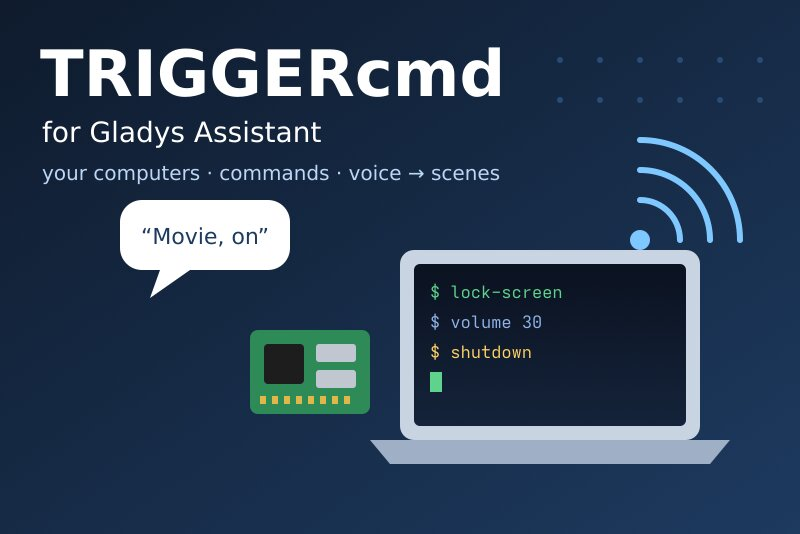
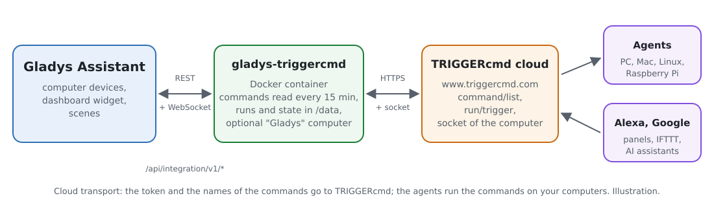
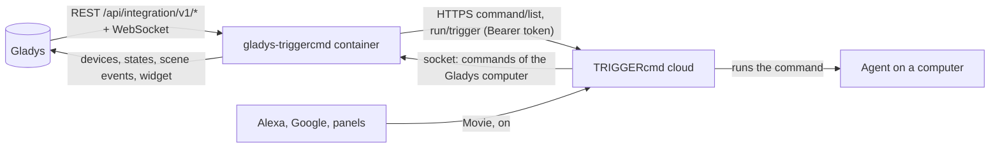
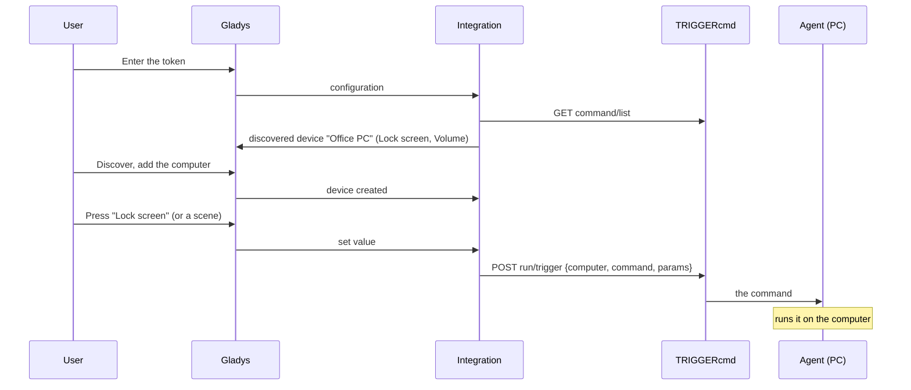
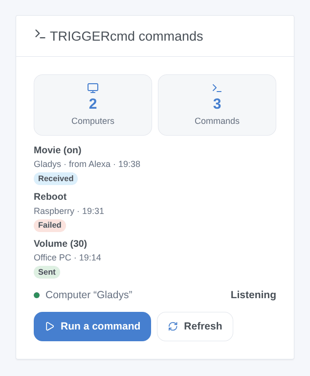

# Gladys TRIGGERcmd

**English** · [Français](README.fr.md) · [Deutsch](README.de.md) · [Español](README.es.md)

[](LICENSE)
[](https://github.com/William-De71/gladys-triggercmd/releases)
[](https://github.com/William-De71/gladys-triggercmd/actions/workflows/release.yml)
[](https://gladysassistant.com)



[Gladys Assistant](https://gladysassistant.com) external integration for [TRIGGERcmd](https://www.triggercmd.com), through its API and the token of your account. It runs the commands of your computers (Windows, Mac, Linux, Raspberry Pi with the TRIGGERcmd agent) from Gladys devices, scenes and a dashboard widget, and, with the optional "Gladys" computer, starts Gladys scenes from Alexa, Google Assistant or a TRIGGERcmd panel.

User documentation: [English](docs/en.md) · [Français](docs/fr.md) · [Deutsch](docs/de.md) · [Español](docs/es.md).

Not affiliated with TRIGGERcmd. **Not tested with a real TRIGGERcmd account yet**: the requests follow the TRIGGERcmd documentation and the code of its official agent and clients; the answers to a wrong token were checked live, over HTTP and over the socket.

## Features

- Every **computer** of the account with its **commands**, found by itself, read every 15 minutes and on demand.
- **One device per computer**: a **push button** per command, or an **on/off switch** for a command that accepts parameters (on sends `on`, off sends `off`, the "Off Command" of the agent).
- **Scene action** "run a command" by the names of the computer and the command, with parameters (scene variables allowed), and "read the commands again".
- **3 scene triggers**: a command of the Gladys computer was run (Alexa, Google…), TRIGGERcmd refused a command Gladys sent, the token is refused.
- **A dashboard widget**: the last runs (sent, refused, received with who sent them) and a **Run a command** form listing the commands, with their parameters.
- **The Gladys computer** (optional): Gladys shows up in TRIGGERcmd as one more computer; its commands start Gladys scenes in real time.
- Four languages everywhere: English, French, German, Spanish.

## How it works





From a command to its run:



### Transport

`transports: ["cloud"]`: everything goes through the TRIGGERcmd cloud (`www.triggercmd.com`), which relays the commands to the agents of your computers. **The token, the names of your computers and commands and the parameters leave your network** (to TRIGGERcmd only). The Gladys computer listens on the TRIGGERcmd socket (a WebSocket opened by the integration, no port opened on your network). `/data` keeps a fingerprint of the account, the computers and their commands, the id of the Gladys computer and the last runs — never the token.

## Devices and features

| Device           | Features (category / type)                                                                                                      |
| ---------------- | ------------------------------------------------------------------------------------------------------------------------------- |
| One per computer | One per command: `button` / `push` (pressing it runs the command), or `switch` / `binary` for a command that accepts parameters |

- TRIGGERcmd never says whether a command is "on": a switch shows what Gladys last sent (like Home Assistant).
- External ids rest on the id of the computer in TRIGGERcmd (`ext:triggercmd:computer:<id>`) and a hash of the command name: the agent re-adds a command when it is edited, and runs it by its name.
- A computer without any command is not offered; the Gladys computer neither (its commands start scenes).
- 100 commands per computer at most.

## Scene triggers, actions and widget



**Widget** "TRIGGERcmd commands" (one computer, or all): how many computers and commands, the state of the Gladys computer, the last runs with a badge (sent, failed, received from Alexa…), a **Run a command** button whose form lists the commands (40 at most) with a parameters field, and a **Refresh** button.

**Triggers**:

- **command received**: a command of the Gladys computer was run in TRIGGERcmd (filters: the command, on or off); variables: the command, its parameters, `on` / `off`, who sent it (Alexa, Google Assistant, a panel…);
- **command refused**: TRIGGERcmd refused a command sent from a device or the widget (filter: the reason — unknown command, too many commands, token, subscription, unreachable); never fired by the `run_command` action, which fails instead;
- **token refused**: once per refusal.

**Actions**:

- **run a command**: the computer and the command by their names (case does not matter), optional parameters; outputs the names found and the answer of TRIGGERcmd. A command unknown to the integration makes it read the list again once.
- **read the commands again**: the counts of computers and commands; new commands appear in the discovery.

Examples:

- "Alexa, turn on Movie" → **TRIGGERcmd: command received** (Movie, on) → close the shutters, dim the lights.
- Every evening at 23:00 → **TRIGGERcmd: run a command** (Office PC, Lock screen).
- When **TRIGGERcmd: command refused** → send "{{triggerEvent.data.command}} on {{triggerEvent.data.computer}}: {{triggerEvent.data.message}}".

### The Gladys computer

Turned on in the configuration, the integration creates a computer (named "Gladys" by default) in your TRIGGERcmd account, keeps its commands in line with the list of the configuration (with parameters allowed) and listens to it. Alexa (TRIGGERcmd Smart Home skill), Google Assistant, a TRIGGERcmd panel, IFTTT, Zapier or an AI assistant (MCP) run these commands like any other: Gladys receives them in real time and fires **command received**, then reports "Command ran" to the run list of triggercmd.com. A run sent by Gladys itself never fires a scene, and Gladys refuses to run the Gladys computer from a scene: no loop.

## Requirements

- Gladys Assistant **5.3.0** or later (widgets and scenes of integrations, catalog keywords of Gladys 5.3): older instances cannot install the integration.
- A TRIGGERcmd account, and its agent installed on each computer to drive, with commands.
- The internet: the integration talks to `www.triggercmd.com` only.

### Plans and pace

The free plan of TRIGGERcmd holds **one computer** and runs **one command per minute** (a second one in the same minute is dropped by TRIGGERcmd); the subscription has no limit. The Gladys computer counts as a computer: with a computer already in a free account, it needs the subscription (Gladys says so plainly, and keeps the other features). Reading the commands is not limited; the integration reads them every 15 minutes, one request at a time, and pauses everything after a 429 for its Retry-After.

## Installation

- **From the store**: Integrations → TRIGGERcmd → Install.
- **From the repository URL**: Integrations → external integration → `https://github.com/William-De71/gladys-triggercmd`.
- **Developer mode**: run `npm start` with the variables given by Gladys (see Development).

## Configuration

| Field or button                  | Default | Meaning                                                                                      |
| -------------------------------- | ------- | -------------------------------------------------------------------------------------------- |
| Token                            | —       | Required, a secret: the token of the "Instructions" page of triggercmd.com, never logged     |
| Create the Gladys computer       | off     | Adds the Gladys computer to the account and listens to it                                    |
| Name of the computer             | Gladys  | Its name in TRIGGERcmd; changing it creates another computer                                 |
| Commands                         | —       | The names of its commands, separated by commas (the names Alexa and Google know), 50 at most |
| Test the connection / Diagnostic | —       | The computers and commands, the Gladys computer; the state in the logs, without the token    |

## Usage

1. On triggercmd.com, open the **Instructions** page and copy the token; install the agent on your computers and add commands to them.
2. In Gladys (Integrations → TRIGGERcmd → Configuration): paste the token, press **Test the connection**.
3. **Discover**, then add your computers as devices; add the widget to a dashboard.
4. Optional: turn on the Gladys computer, list its commands, then link the TRIGGERcmd Smart Home skill in the Alexa app (or the action in Google Home) and build scenes on **command received**.

## Development

```bash
npm install
npm test                       # node --test, a fake TRIGGERcmd (in-memory fetch, fake socket), never the network
npm run lint                   # ESLint
npm run format:check           # Prettier
npx github:GladysAssistant/integration-store . --skip-image-check
scripts/build-cover.sh         # cover.jpg from docs/assets/cover.svg
docs/illustrations/render.sh   # docs/assets/widgets.<lang>.png
```

Locally, the SDK reads `GLADYS_HOST_API_URL`, `GLADYS_INTEGRATION_TOKEN` and `GLADYS_INTEGRATION_SELECTOR` (given by Gladys in developer mode), and the integration reads `TZ`. `DEBUG=gladys-integration-sdk` shows the SDK logs.

The only runtime dependency is the SDK: the socket of the Gladys computer is a small socket.io 2 client written over the WebSocket of Node.js (socket.io-client 2 carries an unfixed advisory). The tests cover the HTTP client (bodies, forms, 401 / 403 / 404 / 429 / 5xx), the parsing of the answers, the socket protocol (open, subscription, events, reconnection, refusal), the devices, the widget (`validateWidgetContent`), the manifest, the four languages, the release script, and the whole integration against the fake Gladys of the SDK and a fake TRIGGERcmd. `test/structure.test.js` freezes every key users store.

## Release process


Every merge on `main` runs the CI, then computes the version from the [Conventional Commits](https://www.conventionalcommits.org/) since the last tag: `feat` → minor, `fix` / `perf` → patch, `!` or `BREAKING CHANGE` → major (a minor below 1.0.0); `docs`, `chore`, `ci`, `test`, `style`, `refactor`, `build` alone publish nothing. The changelog section is generated, the tag pushed, the multi-architecture image built, then `main` receives the release commit, the GitHub Release is created and a last job checks the public image, the store validator and the topic.

- The pull request title becomes the squash commit, then the changelog line: write it in English, for the user (`pr-title.yml` checks it). Never edit `CHANGELOG.md` by hand.
- 1.0.0 is a decision: Actions → Release → Run workflow with `release-as: 1.0.0`. `dry-run` shows the version and the notes without publishing.
- **Protected branch**: the release pushes its commit to `main` with `GITHUB_TOKEN`. The `protect-main` ruleset (no deletion, no force-push) lets it through; a stricter rule (pull request required, status checks) would need GitHub Actions in its bypass list, or a GitHub App.
- After the first release, make the `ghcr.io` package public (Package settings → Change visibility), or Gladys cannot pull it.

## Troubleshooting

See [docs/en.md](docs/en.md#troubleshooting). Report issues with the versions of Gladys and of the integration, your TRIGGERcmd plan, the message of **Test the connection** and the result of **Diagnostic** (in the logs of the integration). Never paste your token.

## Contributing

Issues and pull requests are welcome. Run `npm run format:check && npm run lint && npm test` before opening a pull request, and keep every external id and stored key unchanged (see [CLAUDE.md](CLAUDE.md)).

## Security

See [SECURITY.md](SECURITY.md): report vulnerabilities privately. The token is a `secret` field: never logged, never written to `/data`, sent to `www.triggercmd.com` only. Anyone with the token can run the commands of your computers: keep it like a password, and regenerate it on triggercmd.com if it leaks.

## Screenshots to come

The images above are illustrations, not screenshots. Real screenshots will go in `docs/assets/screenshots/` (PNG, 1280 × 800): `configuration.png`, `discovery.png` (the computers offered), `device.png` (a computer with its buttons and switches), `scene-alexa.png` (a scene on "command received"), `dashboard.png` (the widget with real runs).

## License

[Apache License 2.0](LICENSE) — see also [NOTICE](NOTICE). TRIGGERcmd is a trademark of its owner. Thanks to the Gladys documentation and SDK, to TRIGGERcmd for its documentation and its open-source agent and clients, and to the authors of the Home Assistant "TRIGGERcmd" integration.
