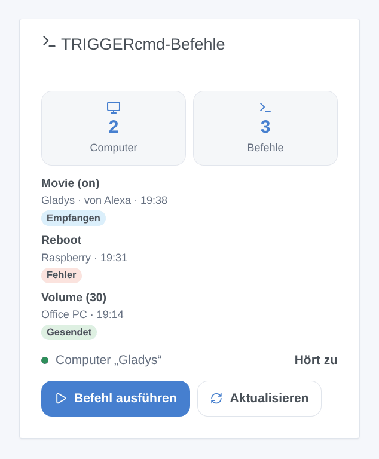

# TRIGGERcmd

## Überblick

[TRIGGERcmd](https://www.triggercmd.com) führt Befehle auf deinen Computern (Windows, Mac, Linux, Raspberry Pi) aus, auf denen sein Agent installiert ist. Diese Integration bringt diese Befehle in Gladys: Jeder Computer wird ein Gerät mit einer Taste (oder einem Ein/Aus-Schalter) pro Befehl, Szenen können jeden Befehl mit Parametern ausführen, und ein Dashboard-Widget zeigt die letzten Ausführungen mit einem Formular, um einen Befehl auszuführen.

Mit dem optionalen **Gladys-Computer** geht es auch umgekehrt: Gladys erscheint in TRIGGERcmd als weiterer Computer, und seine Befehle starten Gladys-Szenen — „Alexa, schalte Film ein“ mit dem Skill TRIGGERcmd Smart Home, Google Assistant, ein TRIGGERcmd-Panel, IFTTT oder ein KI-Assistent.

Alles läuft über die TRIGGERcmd-Cloud (`www.triggercmd.com`): Das Token, die Namen deiner Computer und Befehle und die Parameter verlassen dein Netzwerk, nur zu TRIGGERcmd. Diese Integration ist nicht mit TRIGGERcmd verbunden und wurde noch nicht mit einem echten Konto getestet.

## Voraussetzungen

- Gladys Assistant 5.3.0 oder neuer.
- Ein TRIGGERcmd-Konto (kostenlos oder mit Abonnement).
- Der TRIGGERcmd-Agent auf jedem zu steuernden Computer, mit Befehlen (sein grafischer Befehlseditor oder seine Datei `commands.json`).
- Der kostenlose Tarif von TRIGGERcmd erlaubt **einen Computer** und führt **einen Befehl pro Minute** aus: Ein zweiter Befehl in derselben Minute wird von TRIGGERcmd verworfen. Der Gladys-Computer zählt als weiterer Computer.

## Konfiguration

1. Melde dich auf triggercmd.com an und öffne die Seite **Instructions** (`https://www.triggercmd.com/user/computer/create`): Kopiere das angezeigte Token (das, nach dem der Agent fragt).
2. Öffne in Gladys Integrationen → TRIGGERcmd → Konfiguration, füge das Token ein und speichere.
3. Drücke **Verbindung testen**: Sie listet deine Computer auf und zählt ihre Befehle.

| Feld                    | Bedeutung                                                                                                                |
| ----------------------- | ------------------------------------------------------------------------------------------------------------------------ |
| Token                   | Pflicht. Geheim: nie wieder angezeigt, nie protokolliert. Wer es hat, kann deine Befehle ausführen: Behalte es für dich. |
| Gladys-Computer anlegen | Standardmäßig aus. Fügt den Gladys-Computer deinem TRIGGERcmd-Konto hinzu und hört auf seine Befehle.                    |
| Name des Computers      | Standardmäßig „Gladys“. Eine Änderung legt einen weiteren Computer an (lösche den alten auf triggercmd.com).             |
| Befehle                 | Die Namen der Befehle des Gladys-Computers, durch Kommas getrennt, höchstens 50: „Film, Gute Nacht, Aufwachen“.          |

## Verwendung

### Geräte

Öffne die **Erkennung**: Jeder Computer mit Befehlen wird als Gerät angeboten. Füge die gewünschten hinzu.

- Ein Befehl **ohne Parameter** ist eine Taste: Ein Druck führt den Befehl aus.
- Ein Befehl, der **Parameter erlaubt** („Allow Parameters“ im Agenten), ist ein Ein/Aus-Schalter: Ein führt ihn mit dem Parameter `on` aus, Aus mit `off` (der Agent führt für `off` sein „Off Command“ aus). TRIGGERcmd sagt nie, ob der Befehl an ist: Der Schalter zeigt, was Gladys zuletzt gesendet hat.

Die Befehle werden alle 15 Minuten neu gelesen: Ein neuer Befehl erscheint in der Erkennung (drücke **Aktualisieren** am Gerät).

### Dashboard-Widget

Das Widget **TRIGGERcmd-Befehle** zeigt einen Computer (Einstellung) oder alle: die Anzahl der Computer und Befehle, den Zustand des Gladys-Computers, die letzten Ausführungen (gesendet, fehlgeschlagen oder empfangen mit Absender) und eine Schaltfläche **Befehl ausführen**. Ihr Formular listet die Befehle auf (höchstens 40) und hat ein Feld **Parameter** für Befehle, die Parameter erlauben. **Aktualisieren** liest die Befehle neu.

### Szenen

**Aktionen**:

- **TRIGGERcmd: Befehl ausführen** — Computer und Befehl nach ihren Namen (wie in TRIGGERcmd, Groß- und Kleinschreibung egal) und optionale Parameter (Szenenvariablen funktionieren). Ausgaben: die gefundenen Namen und die Antwort von TRIGGERcmd. Die Aktion schlägt fehl, wenn der Befehl unbekannt ist, TRIGGERcmd ihn ablehnt oder er den Gladys-Computer betrifft.
- **TRIGGERcmd: Befehle neu lesen** — liest Computer und Befehle neu; gibt ihre Anzahl zurück.

**Auslöser**:

- **TRIGGERcmd: Befehl empfangen** — ein Befehl des Gladys-Computers wurde ausgeführt. Filter: der Befehl (sein genauer Name), ein oder aus. Variablen: `command`, `params`, `state` (`on`, `off` oder leer), `sender` (Alexa, Google Assistant…), `computer`.
- **TRIGGERcmd: Befehl abgelehnt** — TRIGGERcmd hat einen Befehl von einem Gerät oder dem Widget abgelehnt. Filter: der Grund (unbekannter Befehl, zu viele Befehle, Token abgelehnt, Abo erforderlich, TRIGGERcmd nicht erreichbar, anderer). Variablen: `computer`, `command`, `reason`, `message`.
- **TRIGGERcmd: Token abgelehnt** — einmal pro Ablehnung.

Beispiele:

- „Alexa, schalte Film ein“ → **Befehl empfangen** (Befehl: Film, Zustand: on) → Rollläden schließen, Wohnzimmer dimmen.
- Jeden Abend um 23:00 → **Befehl ausführen** (Computer: Büro-PC, Befehl: Bildschirm sperren).
- **Befehl abgelehnt** → Nachricht „{{triggerEvent.data.command}}: {{triggerEvent.data.message}}“ senden.

### Der Gladys-Computer

Schalte **Gladys-Computer anlegen** ein und liste seine Befehle auf. Die Integration legt den Computer in deinem TRIGGERcmd-Konto an (oder findet ihn wieder), fügt die Befehle hinzu (Parameter erlaubt, ihr Sprachname ist ihr Name), entfernt die, die du aus der Liste nimmst, und hört in Echtzeit auf ihn.

Für Alexa: Aktiviere den Skill **TRIGGERcmd Smart Home** in der Alexa-App und suche nach Geräten; jeder Befehl wird ein Gerät („Alexa, schalte Film ein“ sendet `on`, „schalte aus“ sendet `off`). Google Home funktioniert genauso mit der TRIGGERcmd-Aktion. Jede Ausführung löst in Gladys **Befehl empfangen** aus und erscheint im Widget.

Ein von Gladys selbst gesendeter Befehl löst nie eine Szene aus, und der Gladys-Computer lässt sich nicht aus einer Gladys-Szene steuern: keine Schleife. Das Ausschalten der Option beendet das Zuhören, lässt den Computer aber in TRIGGERcmd: Lösche ihn auf triggercmd.com, wenn du ihn nicht mehr willst.

## Fehlerbehebung

- **„TRIGGERcmd lehnt das Token ab“**: Kopiere das Token erneut von der Seite Instructions auf triggercmd.com (es ändert sich, wenn du es neu erzeugst) und speichere.
- **Kein Gerät in der Erkennung**: Der Agent muss auf dem Computer laufen und der Computer muss Befehle haben; drücke **Verbindung testen** und starte die Erkennung erneut.
- **Ein Befehl bewirkt nichts**: Im kostenlosen Tarif nur ein Befehl pro Minute; sieh dir die Ausführungsliste auf triggercmd.com an und prüfe, ob der Agent auf dem Computer läuft.
- **„Dein Tarif erlaubt nur einen Computer“**: Der Gladys-Computer braucht ein Abonnement, wenn das Konto schon einen Computer hat; der Rest funktioniert weiter.
- **„Unbekannter Befehl“** in einer Szene: Prüfe die genauen Namen des Computers und des Befehls in TRIGGERcmd.
- Für ein Issue: Versionen von Gladys und der Integration, dein Tarif, die Meldung von **Verbindung testen** und die Zeilen „TRIGGERcmd diagnostic“, die **Diagnose** in die Logs schreibt (ohne Token).
