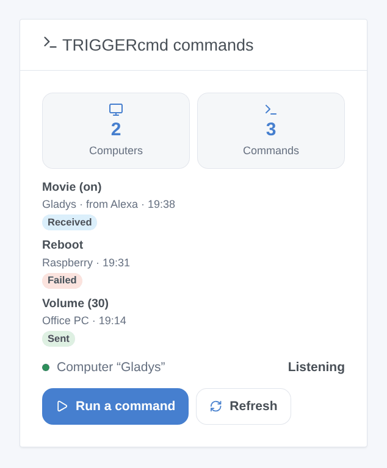

# TRIGGERcmd

## Overview

[TRIGGERcmd](https://www.triggercmd.com) runs commands on your computers (Windows, Mac, Linux, Raspberry Pi) where its agent is installed. This integration brings those commands into Gladys: each computer becomes a device with a button (or an on/off switch) per command, scenes can run any command with parameters, and a dashboard widget shows the last runs with a form to run a command.

With the optional **Gladys computer**, it works the other way too: Gladys shows up in TRIGGERcmd as one more computer, and its commands start Gladys scenes — "Alexa, turn on Movie" with the TRIGGERcmd Smart Home skill, Google Assistant, a TRIGGERcmd panel, IFTTT or an AI assistant.

Everything goes through the TRIGGERcmd cloud (`www.triggercmd.com`): the token, the names of your computers and commands and the parameters leave your network, to TRIGGERcmd only. This integration is not affiliated with TRIGGERcmd and was not tested with a real account yet.

## Prerequisites

- Gladys Assistant 5.3.0 or later.
- A TRIGGERcmd account (free or with a subscription).
- The TRIGGERcmd agent installed on each computer to drive, with commands (its GUI Command Editor, or its `commands.json` file).
- The free plan of TRIGGERcmd holds **one computer** and runs **one command per minute**: a second command in the same minute is dropped by TRIGGERcmd. The Gladys computer counts as one more computer.

## Configuration

1. On triggercmd.com, sign in and open the **Instructions** page (`https://www.triggercmd.com/user/computer/create`): copy the token it shows (the one the agent asks for).
2. In Gladys, open Integrations → TRIGGERcmd → Configuration, paste the token and save.
3. Press **Test the connection**: it lists your computers and counts their commands.

| Field                      | Meaning                                                                                                          |
| -------------------------- | ---------------------------------------------------------------------------------------------------------------- |
| Token                      | Required. A secret: never shown again, never logged. Anyone with it can run your commands: keep it private.      |
| Create the Gladys computer | Off by default. Adds the Gladys computer to your TRIGGERcmd account and listens to its commands.                 |
| Name of the computer       | "Gladys" by default. Changing it creates another computer (delete the old one on triggercmd.com).                |
| Commands                   | The names of the commands of the Gladys computer, separated by commas, 50 at most: "Movie, Good night, Wake up". |

## Usage

### Devices

Open **Discover**: each computer with commands is offered as a device. Add the ones you want.

- A command **without parameters** is a push button: pressing it runs the command.
- A command that **allows parameters** ("Allow Parameters" in the agent) is an on/off switch: on runs it with the parameter `on`, off with `off` (the agent runs its "Off Command" for `off`). TRIGGERcmd never says whether the command is on: the switch shows what Gladys last sent.

The commands are read again every 15 minutes: a new command appears in Discover (press **Update** on the device).

### Dashboard widget

The **TRIGGERcmd commands** widget shows one computer (setting) or all of them: the number of computers and commands, the state of the Gladys computer, the last runs (sent, failed, or received with who sent them) and a **Run a command** button. Its form lists the commands (40 at most) and has a **Parameters** field, for the commands that allow parameters. **Refresh** reads the commands again.

### Scenes

**Actions**:

- **TRIGGERcmd: run a command** — the computer and the command by their names (as in TRIGGERcmd, case does not matter), and optional parameters (scene variables work). Its outputs: the names found and the answer of TRIGGERcmd. The action fails if the command is unknown, if TRIGGERcmd refuses it, or if it targets the Gladys computer.
- **TRIGGERcmd: read the commands** — reads the computers and commands again; outputs their counts.

**Triggers**:

- **TRIGGERcmd: command received** — a command of the Gladys computer was run. Filters: the command (its exact name), on or off. Variables: `command`, `params`, `state` (`on`, `off` or empty), `sender` (Alexa, Google Assistant…), `computer`.
- **TRIGGERcmd: command refused** — TRIGGERcmd refused a command sent from a device or the widget. Filter: the reason (unknown command, too many commands, token refused, subscription needed, TRIGGERcmd unreachable, other). Variables: `computer`, `command`, `reason`, `message`.
- **TRIGGERcmd: token refused** — once per refusal.

Examples:

- "Alexa, turn on Movie" → **command received** (command: Movie, state: on) → close the shutters, dim the living room.
- Every evening at 23:00 → **run a command** (computer: Office PC, command: Lock screen).
- **command refused** → send a message "{{triggerEvent.data.command}}: {{triggerEvent.data.message}}".

### The Gladys computer

Turn on **Create the Gladys computer** and list its commands. The integration creates the computer in your TRIGGERcmd account (or finds it again), adds the commands (with parameters allowed, their voice name being their name), removes the ones you take off the list, and listens to it in real time.

For Alexa: enable the **TRIGGERcmd Smart Home** skill in the Alexa app and discover devices; each command becomes a device ("Alexa, turn on Movie" sends `on`, "turn off" sends `off`). Google Home works the same way with the TRIGGERcmd action. Each run fires **command received** in Gladys and shows in the widget.

A command sent by Gladys itself never fires a scene, and the Gladys computer cannot be run from a Gladys scene: no loop. Turning the option off stops listening but leaves the computer in TRIGGERcmd: delete it on triggercmd.com if you no longer want it.

## Troubleshooting

- **"TRIGGERcmd refuses the token"**: copy the token again from the Instructions page of triggercmd.com (it changes if you regenerate it) and save.
- **No device in Discover**: the agent must run on the computer and the computer must have commands; press **Test the connection**, then Discover again.
- **A command does nothing**: on the free plan, one command per minute only; look at the run list on triggercmd.com, and check that the agent is running on the computer.
- **"Your plan allows a single computer"**: the Gladys computer needs a subscription when the account already has a computer; the rest keeps working.
- **"Unknown command"** in a scene: check the exact names of the computer and of the command in TRIGGERcmd.
- For an issue, give the versions of Gladys and of the integration, your plan, the message of **Test the connection** and the "TRIGGERcmd diagnostic" lines written to the logs by **Diagnostic** (no token in them).
