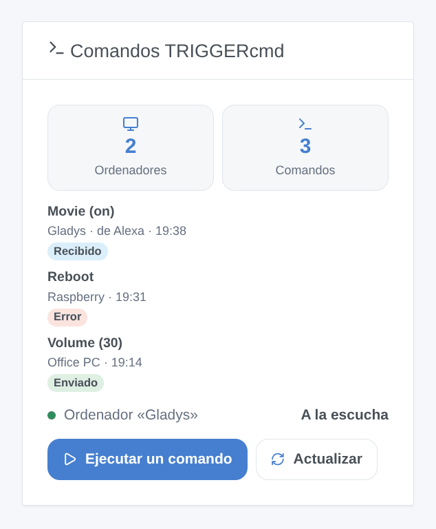

# TRIGGERcmd

## Presentación

[TRIGGERcmd](https://www.triggercmd.com) ejecuta comandos en sus ordenadores (Windows, Mac, Linux, Raspberry Pi) donde está instalado su agente. Esta integración lleva esos comandos a Gladys: cada ordenador se convierte en un dispositivo con un pulsador (o un interruptor encendido/apagado) por comando, las escenas pueden ejecutar cualquier comando con parámetros, y un widget muestra las últimas ejecuciones con un formulario para ejecutar un comando.

Con el **ordenador Gladys** opcional, también funciona al revés: Gladys aparece en TRIGGERcmd como un ordenador más, y sus comandos lanzan escenas de Gladys — «Alexa, enciende Película» con la skill TRIGGERcmd Smart Home, Google Assistant, un panel de TRIGGERcmd, IFTTT o un asistente de IA.

Todo pasa por la nube de TRIGGERcmd (`www.triggercmd.com`): el token, los nombres de sus ordenadores y comandos y los parámetros salen de su red, solo hacia TRIGGERcmd. Esta integración no está afiliada a TRIGGERcmd y aún no se ha probado con una cuenta real.

## Requisitos

- Gladys Assistant 5.3.0 o posterior.
- Una cuenta de TRIGGERcmd (gratuita o con suscripción).
- El agente de TRIGGERcmd instalado en cada ordenador que se quiera controlar, con comandos (su editor gráfico de comandos, o su archivo `commands.json`).
- El plan gratuito de TRIGGERcmd admite **un ordenador** y ejecuta **un comando por minuto**: TRIGGERcmd descarta un segundo comando en el mismo minuto. El ordenador Gladys cuenta como un ordenador más.

## Configuración

1. En triggercmd.com, inicie sesión y abra la página **Instructions** (`https://www.triggercmd.com/user/computer/create`): copie el token que aparece (el que pide el agente).
2. En Gladys, abra Integraciones → TRIGGERcmd → Configuración, pegue el token y guarde.
3. Pulse **Probar la conexión**: lista sus ordenadores y cuenta sus comandos.

| Campo                     | Función                                                                                                                      |
| ------------------------- | ---------------------------------------------------------------------------------------------------------------------------- |
| Token                     | Obligatorio. Secreto: nunca se vuelve a mostrar ni se registra. Quien lo tenga puede ejecutar sus comandos: guárdelo.        |
| Crear el ordenador Gladys | Desactivado por defecto. Añade el ordenador Gladys a su cuenta de TRIGGERcmd y escucha sus comandos.                         |
| Nombre del ordenador      | «Gladys» por defecto. Cambiarlo crea otro ordenador (elimine el antiguo en triggercmd.com).                                  |
| Comandos                  | Los nombres de los comandos del ordenador Gladys, separados por comas, 50 como máximo: «Película, Buenas noches, Despertar». |

## Uso

### Dispositivos

Abra el **Descubrimiento**: cada ordenador con comandos se ofrece como dispositivo. Añada los que quiera.

- Un comando **sin parámetros** es un pulsador: pulsarlo ejecuta el comando.
- Un comando que **acepta parámetros** («Allow Parameters» en el agente) es un interruptor encendido/apagado: encendido lo ejecuta con el parámetro `on`, apagado con `off` (el agente ejecuta su «Off Command» para `off`). TRIGGERcmd nunca dice si el comando está encendido: el interruptor muestra lo último que Gladys envió.

Los comandos se releen cada 15 minutos: un comando nuevo aparece en el Descubrimiento (pulse **Actualizar** en el dispositivo).

### Widget

El widget **Comandos TRIGGERcmd** muestra un ordenador (ajuste) o todos: el número de ordenadores y comandos, el estado del ordenador Gladys, las últimas ejecuciones (enviadas, con error o recibidas con su remitente) y un botón **Ejecutar un comando**. Su formulario lista los comandos (40 como máximo) y tiene un campo **Parámetros**, para los comandos que los aceptan. **Actualizar** relee los comandos.

### Escenas

**Acciones**:

- **TRIGGERcmd: ejecutar un comando** — el ordenador y el comando por sus nombres (como en TRIGGERcmd, mayúsculas indiferentes), y parámetros opcionales (funcionan las variables de escena). Salidas: los nombres encontrados y la respuesta de TRIGGERcmd. La acción falla si el comando es desconocido, si TRIGGERcmd lo rechaza o si apunta al ordenador Gladys.
- **TRIGGERcmd: releer los comandos** — relee los ordenadores y comandos; devuelve su número.

**Disparadores**:

- **TRIGGERcmd: comando recibido** — se ejecutó un comando del ordenador Gladys. Filtros: el comando (su nombre exacto), encender o apagar. Variables: `command`, `params`, `state` (`on`, `off` o vacío), `sender` (Alexa, Google Assistant…), `computer`.
- **TRIGGERcmd: comando rechazado** — TRIGGERcmd rechazó un comando enviado desde un dispositivo o el widget. Filtro: el motivo (comando desconocido, demasiados comandos, token rechazado, requiere suscripción, TRIGGERcmd inaccesible, otro). Variables: `computer`, `command`, `reason`, `message`.
- **TRIGGERcmd: token rechazado** — una vez por rechazo.

Ejemplos:

- «Alexa, enciende Película» → **comando recibido** (comando: Película, estado: on) → cerrar las persianas, atenuar el salón.
- Cada noche a las 23:00 → **ejecutar un comando** (ordenador: PC de la oficina, comando: Bloquear pantalla).
- **comando rechazado** → enviar un mensaje «{{triggerEvent.data.command}}: {{triggerEvent.data.message}}».

### El ordenador Gladys

Active **Crear el ordenador Gladys** y liste sus comandos. La integración crea el ordenador en su cuenta de TRIGGERcmd (o lo vuelve a encontrar), añade los comandos (parámetros permitidos, su nombre de voz es su nombre), quita los que retire de la lista y lo escucha en tiempo real.

Para Alexa: active la skill **TRIGGERcmd Smart Home** en la aplicación Alexa y busque dispositivos; cada comando se convierte en un dispositivo («Alexa, enciende Película» envía `on`, «apaga» envía `off`). Google Home funciona igual con la acción de TRIGGERcmd. Cada ejecución dispara **comando recibido** en Gladys y aparece en el widget.

Un comando enviado por la propia Gladys nunca dispara una escena, y el ordenador Gladys no se controla desde una escena de Gladys: sin bucle. Desactivar la opción detiene la escucha pero deja el ordenador en TRIGGERcmd: elimínelo en triggercmd.com si ya no lo quiere.

## Solución de problemas

- **«TRIGGERcmd rechaza el token»**: copie de nuevo el token desde la página Instructions de triggercmd.com (cambia si lo regenera) y guarde.
- **Ningún dispositivo en el Descubrimiento**: el agente debe estar en marcha en el ordenador y el ordenador debe tener comandos; pulse **Probar la conexión** y vuelva a lanzar el Descubrimiento.
- **Un comando no hace nada**: con el plan gratuito, un solo comando por minuto; mire la lista de ejecuciones en triggercmd.com y compruebe que el agente está en marcha en el ordenador.
- **«Su plan solo permite un ordenador»**: el ordenador Gladys necesita una suscripción cuando la cuenta ya tiene un ordenador; el resto sigue funcionando.
- **«Comando desconocido»** en una escena: compruebe los nombres exactos del ordenador y del comando en TRIGGERcmd.
- Para una incidencia, indique las versiones de Gladys y de la integración, su plan, el mensaje de **Probar la conexión** y las líneas «TRIGGERcmd diagnostic» que **Diagnóstico** escribe en los registros (sin el token).
